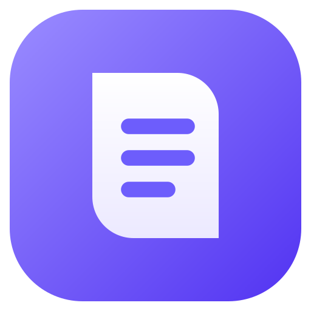
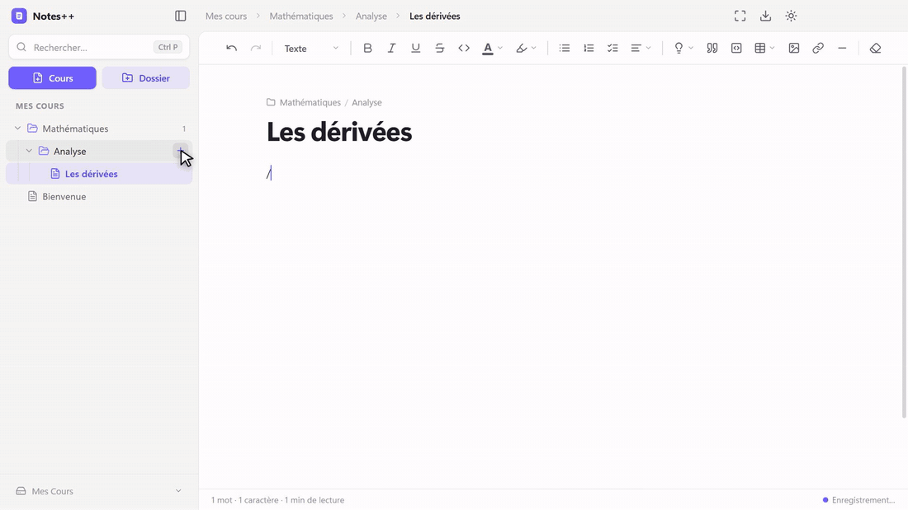
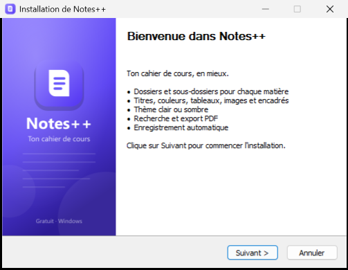

<p align="center">
  
</p>

<h1 align="center">Notes++</h1>

<p align="center"><b>Ton cahier de cours, en mieux.</b><br>Comme le Bloc-notes, mais avec de la vraie mise en forme, des dossiers et un beau design.</p>

<p align="center">
  <a href="https://github.com/Maxence-P-dev/notes-plus-plus/releases/latest/download/NotesPlusPlus-Setup.exe"></a>
  <a href="https://github.com/Maxence-P-dev/notes-plus-plus/releases/latest/download/NotesPlusPlus-Portable.zip"></a>
</p>

<p align="center">
  <a href="https://github.com/Maxence-P-dev/notes-plus-plus/releases/latest"></a>
  
  
  
</p>

<p align="center">
  <a href="docs/presentation.mp4"></a>
</p>

<p align="center"><a href="docs/presentation.mp4"><b>Regarder la présentation en vidéo</b></a> (2 min 37)</p>

## Fonctionnalités

<p align="center">
  
</p>

- **Dossiers et sous-dossiers** illimités pour ranger ses cours, avec glisser-déposer, renommage et clic droit.
- **Mise en forme riche** : titres, gras, italique, souligné, couleurs, surlignage, listes, cases à cocher, citations, code, tableaux, images, liens, alignement.
- **Images** à placer où tu veux : à gauche, au centre, à droite, ou avec du texte à côté. Redimensionnables et déplaçables.
- **Encadrés de cours** : *Info*, *Définition*, *Attention*, *À retenir*.
- **Flashcards et révision espacée** : les encadrés *Définition* et *À retenir* deviennent automatiquement des cartes de révision, à la manière d'Anki. Notes *À revoir*, *Difficile*, *Bien*, *Facile* : chaque carte revient au bon moment (`Ctrl+Maj+R`).
- **Formules mathématiques** (LaTeX) : dans la ligne ou centrées, avec aperçu en direct et boutons pour les symboles courants (fraction, racine, intégrale, limite…). Aussi dans l'export PDF et sur les flashcards.
- **PDF** : importe tes PDF (sujets, polys, corrigés) dans tes dossiers et lis-les directement dans Notes++, à côté de tes cours.
- **Menu `/`** : tape `/` pour insérer n'importe quel bloc sans quitter le clavier.
- **Thème clair, sombre ou système**.
- **Enregistrement automatique** pendant que tu écris.
- **Recherche** dans les titres et dans le contenu de tous les cours (`Ctrl+P`).
- **Export PDF** propre, au format A4 et paginé (`Ctrl+Maj+E`).
- **IA intégrée, gratuite et hors ligne** : elle tourne directement sur ton ordinateur (aucun compte, aucune clé, tes cours ne quittent pas ton PC). Correction des fautes avec explication, schémas générés à partir du cours (carte mentale, frise, étapes, cycle, comparaison, organigramme, fiches) et suggestions de pictogrammes. Le modèle (1 à 2 Go) se télécharge une seule fois depuis les Paramètres.
- **Pictogrammes** : près de 1 900 dessins en couleur, avec une recherche en français.
- **Formes libres** : rectangles, cercles, bulles, flèches, étoiles… à placer, redimensionner, colorer et remplir de texte.
- **Paramètres** : couleur principale de l’appli (10 couleurs ou la tienne), police des cours (moderne, classique, manuscrite), taille du texte.
- **Mises à jour automatiques** : Notes++ te prévient quand une nouvelle version sort, et l’installe en un clic.
- **Mode concentration** en plein écran (`F11`), zoom (`Ctrl +` / `Ctrl −`), correcteur orthographique en français.

Les cours sont de simples fichiers `.cours` (en HTML) dans `Documents\Mes Cours`. Tu peux changer ce dossier depuis le bas de la barre latérale, par exemple pour le mettre dans OneDrive.
## Installation

<table>
<tr>
<td width="55%">

1. Clique sur **[Télécharger l'installeur](https://github.com/Maxence-P-dev/notes-plus-plus/releases/latest/download/NotesPlusPlus-Setup.exe)**.
2. Ouvre `NotesPlusPlus-Setup.exe`.
3. Clique sur **Suivant** jusqu'à la fin : Notes++ se lance tout seul.

Un raccourci est ajouté sur le bureau et dans le menu Démarrer.

**Sans installation ?** Prends la [version portable](https://github.com/Maxence-P-dev/notes-plus-plus/releases/latest/download/NotesPlusPlus-Portable.zip), décompresse-la et lance `Notes++.exe`.

</td>
<td width="45%"></td>
</tr>
</table>

> [!NOTE]
> L'application n'est pas signée numériquement. Si Windows affiche « Windows a protégé votre ordinateur », clique sur **Informations complémentaires**, puis sur **Exécuter quand même**.

## Raccourcis

| Action | Raccourci |
| --- | --- |
| Nouveau cours | `Ctrl+N` |
| Nouveau dossier | `Ctrl+Maj+N` |
| Rechercher | `Ctrl+P` |
| Réviser mes cartes | `Ctrl+Maj+R` |
| Insérer un bloc | `/` |
| Lien | `Ctrl+K` |
| Thème clair / sombre | `Ctrl+Maj+L` |
| Afficher / masquer la barre latérale | `Ctrl+\` |
| Exporter en PDF | `Ctrl+Maj+E` |
| Mode concentration | `F11` |
| Zoom | `Ctrl +` / `Ctrl −` / `Ctrl 0` |
| Renommer / supprimer (dans l'arborescence) | `F2` / `Suppr` |

## Développement

Il faut [Node.js](https://nodejs.org) 20 ou plus récent.

```bash
npm install
npm start        # lance l'application
npm test         # tests (révision espacée, flashcards)
npm run dist     # crée l'installeur et le zip dans release/
```

L'application est construite avec Electron et l'éditeur TipTap. Le code est organisé ainsi :

- `app/main.js` : fenêtre, fichiers et dossiers, export PDF
- `app/preload.js` : pont sécurisé entre la fenêtre et le système
- `src/renderer/` : interface (arborescence, barre d'outils, éditeur, menu `/`, révision, formules)
- `app/styles.css` et `app/content.css` : thème de l'interface et style des cours ; `review.css`, `math.css`, `pdf.css` pour la révision, les formules et le lecteur PDF
- `scripts/demo/` : génération automatique de la vidéo de présentation (narration, enregistrement, montage)

## Licence

MIT pour le code de Notes++.

- L'IA utilise [Llama 3.2](https://www.llama.com/llama3_2/license/) (Built with Llama) ou [Qwen 2.5](https://huggingface.co/Qwen/Qwen2.5-1.5B-Instruct) (Apache 2.0), exécutés avec [node-llama-cpp](https://github.com/withcatai/node-llama-cpp).
- Pictogrammes : [Twemoji](https://github.com/jdecked/twemoji) (CC-BY 4.0), noms français : [Emojibase](https://emojibase.dev) (MIT).
